<div align="center">

<picture>
  <source media="(prefers-color-scheme: dark)" srcset=".github/assets/banner-dark.svg">
  
</picture>

**Depend on the extension boundary, not an entire framework.**<br>
Small, versioned interfaces for applications, middleware, providers, stability and runtime compatibility.

[](https://packagist.org/packages/pushinbr/pam-contracts)

[](LICENSE)

[Install](#install) · [Quick example](#quick-example) · [API](#api-guide) · [Docs](#docs) · [Issues](https://github.com/push-in/pam-contracts/issues)

</div>

<a id="install"></a>
## <picture></picture> Install

Most applications receive this package transitively. Extension authors install it explicitly inside a PAM project:

```sh
pam composer require pushinbr/pam-contracts
pam doctor
```

New to PAM? Start with `pam init my-app --template http` and `pam dev`. Run `pam doctor` after dependency changes and before a release. The project stays a normal Composer project: standard manifest, lockfile, PSR-4 autoloading and `vendor/autoload.php`.

<a id="quick-example"></a>
## <picture></picture> Quick example

```php
<?php

declare(strict_types=1);

use Pam\Contracts\Http\ApplicationInterface;
use Pam\Contracts\Http\MiddlewareInterface;
use Pam\Contracts\Http\RequestHandlerInterface;
use Pam\Contracts\Package\ServiceProviderInterface;
use Pam\Contracts\Runtime\RuntimeCompatibility;
use Pam\Http\Request;
use Pam\Http\Response;

final class AuditMiddleware implements MiddlewareInterface
{
    public function process(Request $request, Response $response, RequestHandlerInterface $next): Response
    {
        // Inspect the request, then delegate to the next handler.
        return $next->handle($request, $response);
    }
}

final class AuditServiceProvider implements ServiceProviderInterface
{
    public function register(ApplicationInterface $application): void
    {
        $application->middleware(new AuditMiddleware());
    }

    public function boot(ApplicationInterface $application): void
    {
        // Fails fast when the package runs on an incompatible PAM runtime ABI.
        RuntimeCompatibility::discover()->assert();
    }
}
```

`RuntimeCompatibility::discover()` reads the ABI version and capabilities from the PAM runtime (`Pam\Native\Api`) and throws outside it. Pass a list of `Pam\Native\Capability` cases to `assert()` to require specific runtime features.

<a id="why-this-exists"></a>
## <picture></picture> Why this exists

Small, versioned contracts for packages that extend PAM. It contains the HTTP application and middleware contracts, service providers, stability values and native runtime compatibility checks. It does not contain a router or server.

| | |
| --- | --- |
| **Role** | Foundation contract |
| **Execution path** | Strict PHP interfaces |
| **This repository owns** | Stable extension contracts shared across PAM packages |
| **Boundary** | No router, server, framework, or application implementation |

What you can build:

- Publishing framework-independent PAM extensions
- Testing runtime compatibility explicitly
- Sharing middleware and provider contracts without pulling a router

<a id="api-guide"></a>
## <picture></picture> API guide

| Surface | Use it for |
| --- | --- |
| `Http\ApplicationInterface` | Minimal route, middleware, error, and in-memory handling contract. |
| `Http\MiddlewareInterface` | Process a request and delegate to the next handler. |
| `Http\RequestHandlerInterface` | Handle PAM request/response values. |
| `Package\ServiceProviderInterface` | Register and boot package integrations. |
| `Runtime\RuntimeCompatibility` | Discover ABI/capabilities and assert required runtime features. |
| `Runtime\Stability` | Represent the documented contract maturity (`Experimental`, `Stable`, `Deprecated`). |

All classes live under `Pam\Contracts\`. This package intentionally contains no router, server, or application implementation. Depend on it when publishing reusable PAM extensions that need stable contracts without forcing [PAM HTTP](https://github.com/push-in/pam-http) on consumers.

<a id="production-checklist"></a>
## <picture></picture> Production checklist

- Keep request data and mutable state scoped to the current request.
- Test success, validation failure, exception, cancellation, and timeout paths.
- Configure explicit limits and avoid unbounded payloads, queues, or retained collections.
- Run `pam doctor`, `pam test`, and the relevant integration suite before release.
- Validate real dependencies and workload behavior; compatibility is not inferred from package installation alone.

<a id="troubleshooting"></a>
## <picture></picture> Troubleshooting

- **Class not found:** run `pam composer install`, verify PSR-4 configuration, and rerun `pam doctor`.
- **Behavior differs over the network:** reproduce with PAM's transport integration tests; in-memory execution does not model the socket boundary.
- **A dependency blocks a worker:** use PAM-native I/O, a compatible event loop, a process pool, or additional isolated workers.

<a id="docs"></a>
## <picture></picture> Docs

- [PAM introduction](https://push-in.github.io/pam-docs/introduction/)
- [Package ecosystem](https://push-in.github.io/pam-docs/packages/overview/)
- [Runtime compatibility](https://push-in.github.io/pam-docs/runtime/compatibility/)
- [Report an issue](https://github.com/push-in/pam-contracts/issues): report security vulnerabilities through GitHub private vulnerability reporting or the PAM security policy, not a public issue

<a id="pam-ecosystem"></a>
## <picture></picture> Part of the PAM ecosystem

<p align="center"><picture>
  <source media="(prefers-color-scheme: dark)" srcset=".github/assets/pam-wordmark-dark.svg">
  
</picture></p>

PAM runs PHP natively on servers, desktops and phones. This repository is one piece of it.

| [**PAM**](https://github.com/push-in/pam) | [**PAM Desktop**](https://github.com/push-in/pam-desktop) | [**PAM Native**](https://github.com/push-in/pam-native) | [**Ecosystem**](https://github.com/push-in/pam#ecosystem) |
| --- | --- | --- | --- |
| the runtime and CLI | native desktop apps in PHP | native Android and iOS apps in PHP | every official package and plugin |

<sub>Docs: [push-in.github.io/pam-docs](https://push-in.github.io/pam-docs/introduction/) · [Issues](https://github.com/push-in/pam-contracts/issues)</sub>

<p align="center"><sub><a href="LICENSE">Apache License 2.0</a> · free and open source, including commercial use · Made in Brazil by Pushin</sub></p>
